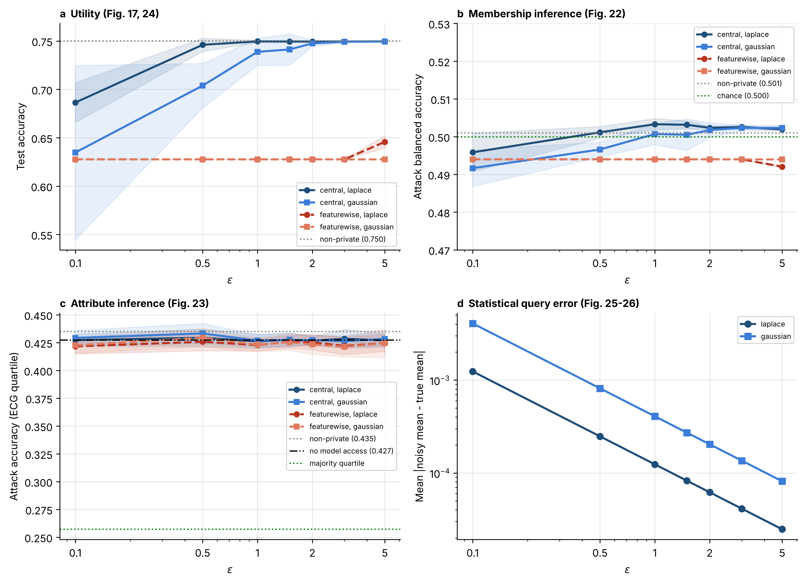

# Optimizing differential privacy parameters in machine learning healthcare models

[](LICENSE)

Codebook for:

> Pierrelouis, N. (2025). *Optimizing differential privacy parameters in machine learning healthcare models: Implementation and pre-deployment for medical device data* [Doctoral dissertation, Marymount University]. Committee: Michelle Liu (Chair), Alex Mbaziira, Monika Kiss.

The dissertation applies differential privacy (DP) to a Gaussian Naive Bayes classifier for atrial-fibrillation detection on wearable cardiac data. It compares the Laplace and Gaussian mechanisms across a grid of privacy budgets, measures membership and attribute inference against the protected model, and checks prediction consistency, inference cost, and the effect on logistic regression and random forest. The procedural frame is the Investigation–Implementation–Assessment (IIA) methodology from Chapter 3.

The codebook runs every experiment in Chapter 4 with one command, using real model outputs at every step. Each table and figure is regenerated from CSVs in `results/`, and each CSV is regenerated from `data/ddata.csv`.

## Headline results (ε = 1.0, five seeds)

| | Laplace (ε-DP) | Gaussian ((ε, δ)-DP) |
|---|---|---|
| NB accuracy (non-private 0.7500) | 0.7496 ± 0.0011 | 0.7388 ± 0.0140 |
| Membership inference, balanced accuracy (chance 0.500) | 0.503 | 0.501 |
| Attribute inference, ECG quartile (no-model control 0.427, majority 0.258) | 0.426 | 0.427 |
| Mean per-record CV of P(AF) across fits | 18.1% | 68.6% |
| Records with the same label in all five fits | 95.7% | 76.4% |
| Laplace vs Gaussian accuracy, paired t (n = 5) | t = 1.857, p = 0.137 | |

On this dataset the rule-based membership attack sits at chance before and after DP. The attribute attack learns the ECG quartile from the other six features, and the model's outputs add nothing measurable to it. With the same budget, central placement keeps accuracy close to the non-private model from ε = 1.0. Feature-wise placement leaves every model at or near the majority class (Table 16).



## Method

Features are min-max scaled to [0, 1] with bounds from the training split; the bounds are treated as public. The data is split 80/20, stratified, with seed 42. Each private configuration is fit with seeds 42–46 at ε ∈ {0.1, 0.5, 1.0, 1.5, 2.0, 3.0, 5.0}, with δ = 10⁻⁵ for the Gaussian mechanism.

| Placement | What is noised | Sensitivity and budget |
|---|---|---|
| central (NB) | per class, one count, d sums and d sums of squares (Vaidya et al., 2013) | 1 each; ε/30 and δ/30 per statistic (sequential composition) |
| feature-wise (Chapter 3 algorithm) | every training record's features, before fitting | 1 per feature; ε/7 per feature, clipped to [0, 1] |
| statistical query (Figures 25–26) | each feature mean, released alone | (max − min)/n; ε |
| central LR (Table 16) | the fitted weight vector (output perturbation; Chaudhuri et al., 2011) | 2/(nλ), λ = 10⁻³ |
| central RF (Table 16) | diffprivlib's DP random forest | Laplace only |

The Laplace mechanism uses scale b = Δ/ε. The Gaussian mechanism uses σ = Δ√(2 ln(1.25/δ))/ε. Within each placement the two mechanisms share one code path and differ only in the distribution drawn.

**Membership inference** is the black-box rule-based attack: a record is called a member if the model classifies it correctly (Yeom et al., 2018; `MembershipInferenceBlackBoxRuleBased` in ART). It is scored as balanced accuracy on 2,000 members and 2,000 non-members.

**Attribute inference** follows the Chapter 3 algorithm:
- The adversary holds a held-out patient's other six features and queries the model.
- An attack random forest predicts the patient's ECG quartile from those six features plus the model's prediction and class probabilities. The quartile edges come from the training fold.
- The attack trains on 80% of the test fold and is scored on the remaining 20%.
- The same attack is also run without the model's outputs. The difference between the two is what the released model adds.

## Repository layout

```
dp-mlhm-dissertation/
├── data/ddata.csv                 100,000-record synthetic cardiac dataset (CTGAN)
├── src/mlhm/
│   ├── config.py                  every constant in Chapters 3-4 (grid, delta, seeds, sizes)
│   ├── data.py                    load, stratified split, public min-max scaling, Table 8
│   ├── mechanisms.py              Laplace/Gaussian; central NB, feature-wise noise, noisy means
│   ├── models.py                  fit(model, placement, mechanism, eps, ...) for NB, LR, RF
│   ├── attacks.py                 membership and attribute inference
│   └── evaluation.py              utility, consistency, inference cost, paired tests
├── experiments/
│   ├── rq1_privacy.py             RQ1: attacks vs epsilon       -> Tables 9-10, Figs 21-23
│   ├── rq2_tradeoff.py            RQ2: utility and mechanisms   -> Tables 11-13, Figs 24-26
│   ├── rq3_performance.py         RQ3: consistency, cost, models -> Tables 14-16
│   └── run_all.py                 all three, then tables and figure
├── tools/
│   ├── make_tables.py             prints Tables 8-16 and writes results/tables.md
│   └── make_figure.py             figures/privacy_utility.png
├── tests/test_codebook.py         unit tests (toy data, a few seconds)
├── results/                       per-seed CSVs and tables.md
├── figures/
└── archive/                       the original notebooks, unchanged, for provenance
```

## Reproducing

```bash
python -m venv .venv && source .venv/bin/activate
pip install -r requirements.txt
python experiments/run_all.py          # about 8 minutes on a laptop CPU
python -m pytest                       # unit tests
```

Each research question also runs on its own (`python experiments/rq1_privacy.py`, and so on). `tools/make_tables.py` and `tools/make_figure.py` read only `results/`, so they run in seconds.

diffprivlib 0.6.6 does not import against scikit-learn 1.9 or later, so `requirements.txt` pins scikit-learn 1.8. Only the central random forest in RQ3 uses diffprivlib.

## Research questions and outputs

| RQ | Question (Chapter 1) | Output | Dissertation |
|---|---|---|---|
| 1 | Does DP reduce membership and attribute inference? | `rq1_privacy.csv`, `rq1_attribute_importance.csv` | Tables 9–10, Figures 19, 21–23 |
| 2 | Which (ε, δ) balance privacy and utility, and how do the mechanisms compare? | `rq2_utility.csv`, `rq2_mechanism_tests.csv`, `rq2_noisy_means.csv` | Tables 11–13, Figures 17, 24–26, the t-test and correlation |
| 3 | What do DP configurations cost in consistency, compute and across models? | `rq3_consistency.csv`, `rq3_cost.csv`, `rq3_architectures.csv` | Tables 14–16, Figures 18, 20 |

## Relationship to the dissertation's numbers

The dissertation was produced with `archive/Differential_Privacy_Analysis.ipynb`. The codebook keeps its design: the same features, target, split, ε grid, δ, mechanisms, attacks and models. Each output is computed directly by a runner. The numbers differ from the printed ones for two reasons.

**Data.** The dissertation used an earlier `ddata.csv` on which the non-private model reached about 98% accuracy. That file is not in the project sources. The file here is the 100,000-record CTGAN dataset regenerated for the follow-up IIS paper (`dp-cardiac-mia`), where the non-private NB reaches 0.750. To run the codebook on the earlier file, place it at `data/ddata.csv` with the same columns and rerun `run_all.py`.

**How each table was produced in the notebook:**

| Dissertation | Notebook source | Codebook |
|---|---|---|
| Table 8 | computed from the data | `describe()` on the current data |
| Table 9 | the baseline attack rate (0.498) times 1 − min(1, 1/ε) for Laplace and 1 − min(1, 0.75/ε + δ term) for Gaussian. No DP model is attacked. | rule-based attack on each fitted DP model |
| Table 10 | Laplace: measured against a DP random forest. Gaussian: the measured non-private rate times the Table 9 factor. | the attack on each DP NB, with the no-model control |
| Tables 11–12 | diffprivlib LR runs. The ε = 1.0 rows do not match a single run (0.9723 is a recall value). | central NB utility, mean (SD) over five seeds |
| Table 13 | combined from Tables 9–12 | combined from the measured tables |
| t-test, correlation (t = 2.3947, p = 0.0748, r = 0.473) | hard-coded accuracy lists | paired test on matched-seed accuracies at every ε |
| Table 14 | `np.random.normal(0.7, 0.005)` and `(0.7, 0.007)` | CV of P(AF) across five real DP fits, plus label agreement |
| Table 15 | no generating cell; the notebook's own timing cell reports about 2 × 10⁷ samples/s | median of 50 timed passes, with peak memory |
| Table 16 | `X = np.random.rand(2000, 20)` with random labels | LR and RF on the cardiac data, both placements and mechanisms |
| Figures 25–26 | noisy feature means | same query, sensitivity (max − min)/n |

The mitigation percentages in Chapter 5 have no generating code, and the codebook does not reproduce them. `archive/CTGAN_sample_generation.ipynb` shows how the synthetic data was generated.

## Citation

See `CITATION.cff`.

## License

MIT; see `LICENSE`. The data is synthetic and contains no patient records.
